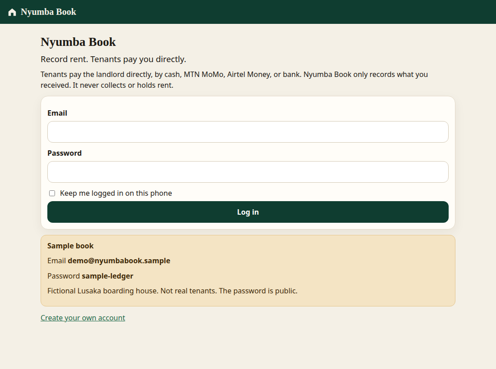
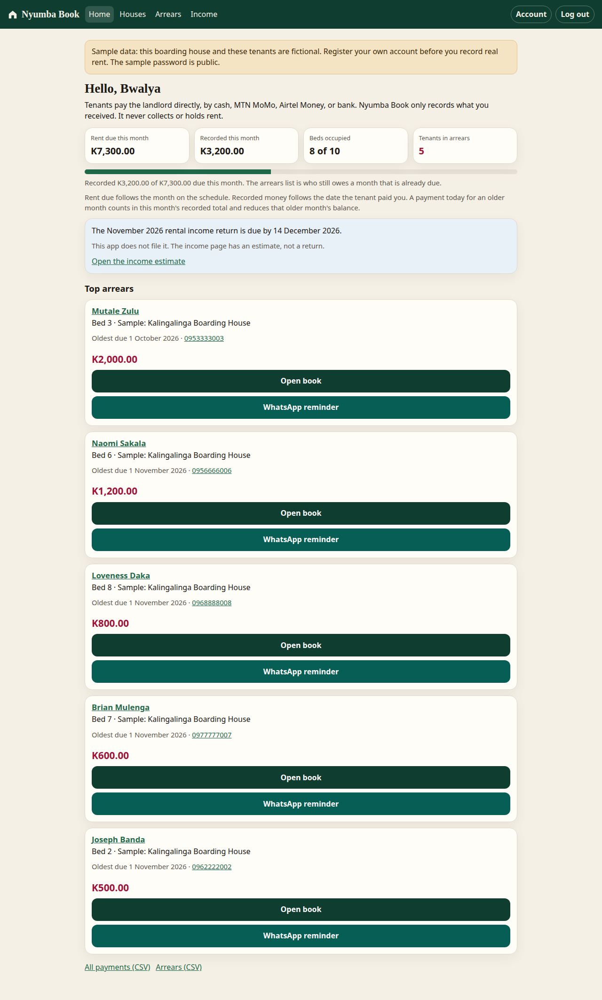
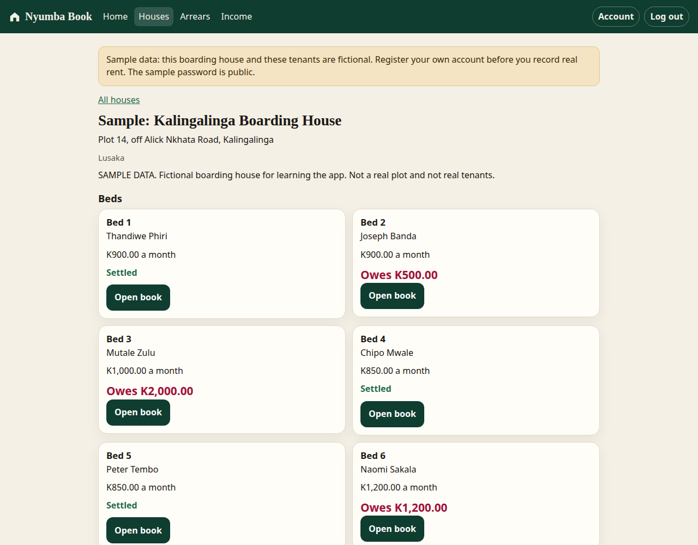
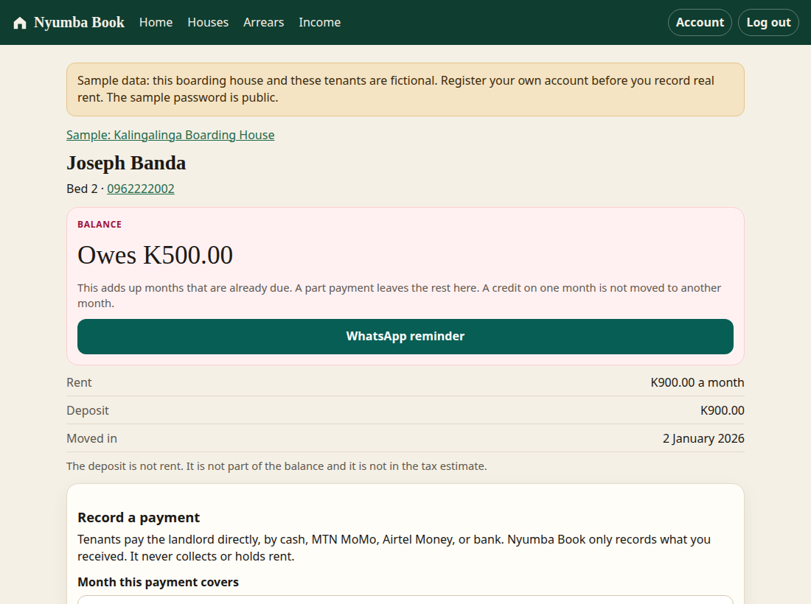
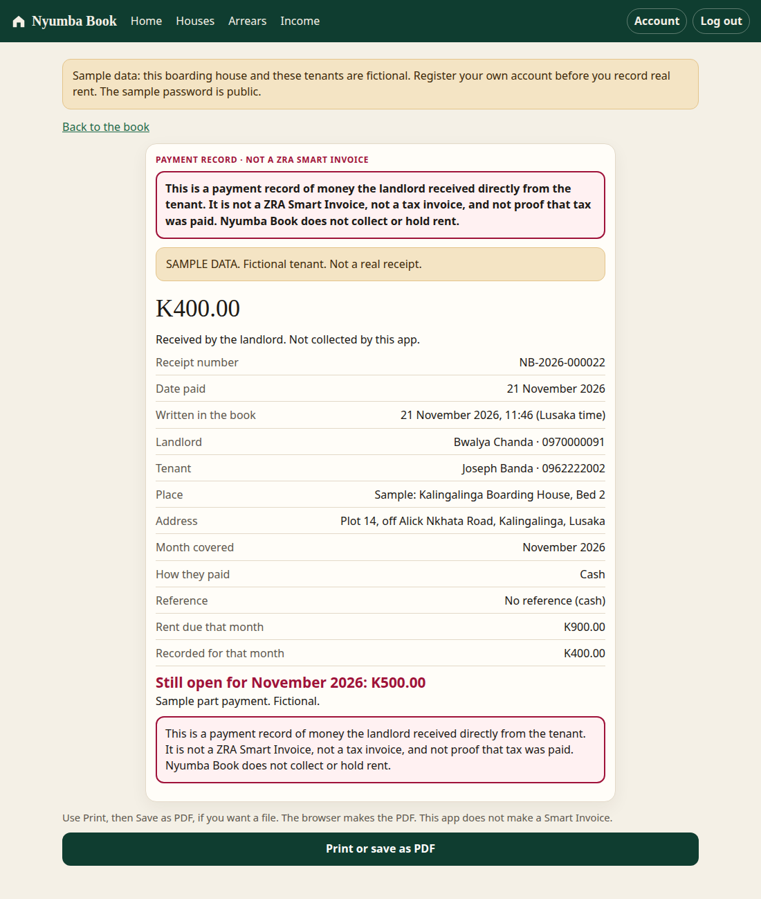
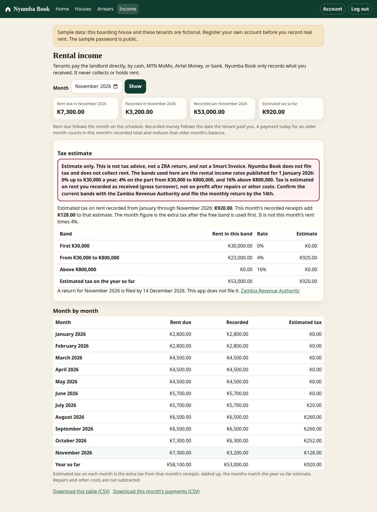
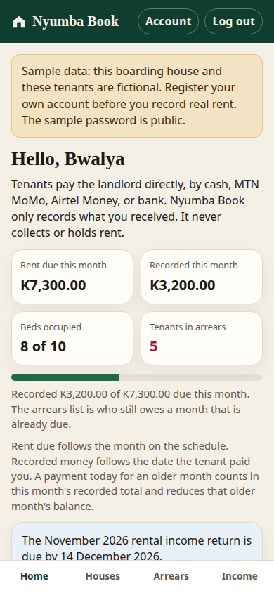

# Nyumba Book

Nyumba Book is a rent record for a small landlord or a boarding-house owner in Zambia. A tenant pays **you** — cash, MTN MoMo, Airtel Money, or bank — and you write that payment in the book. The app stores the amount, the date, and the reference.

It does not collect rent. It does not hold tenant money. It does not talk to MTN, Airtel, or a bank.

This is a starter project for [Wankumbu Musunga](https://github.com/MKBright) (Lusaka), built to be simple enough to run, explain, and change.

## What this app will not do

- It will not collect rent or hold a tenant's money.
- It will not send money to MTN MoMo, Airtel Money, or a bank.
- It will not produce a ZRA Smart Invoice. A receipt here is a **payment record** of money you already received.
- It will not file tax, and it will not give tax advice. The income page is an estimate you can check before you file.
- It will not replace a lawyer, an accountant, or the Zambia Revenue Authority.

## Screenshots

Sample book on a fictional boarding house in Kalingalinga. The people are not real. The amounts move when the month changes, because the sample is built from today's date.















## Run it on your computer

You need Python 3.12 (3.11 or newer is fine).

**macOS or Linux**

```bash
python3 -m venv .venv
source .venv/bin/activate
pip install -r requirements.txt
python seed.py
python run.py
```

**Windows**

```bash
py -m venv .venv
.venv\Scripts\activate
pip install -r requirements.txt
python seed.py
python run.py
```

Open [http://127.0.0.1:5000](http://127.0.0.1:5000).

The sample login is also printed by `python seed.py`:

- Email: `demo@nyumbabook.sample`
- Password: `sample-ledger`

That password is public. It is only for the fictional house. Register your own account before you record real tenants. Running `python seed.py` again replaces the sample house and leaves accounts you created yourself.

`make install`, `make seed`, `make run`, and `make test` do the same steps if you are on macOS or Linux.

## The sample house

`python seed.py` loads **Sample: Kalingalinga Boarding House**, Plot 14, off Alick Nkhata Road, Kalingalinga, Lusaka. It has 10 beds. Eight are occupied. Bed 9 and Bed 10 are empty.

The story, relative to today:

| Tenant | This month |
| --- | --- |
| Thandiwe Phiri, Chipo Mwale, Peter Tembo | Paid in full |
| Joseph Banda | Paid K400 of K900 |
| Brian Mulenga | Paid K200 of K800 |
| Mutale Zulu | Has not paid this month or the month before |
| Naomi Sakala, Loveness Daka | Have not paid this month |

Every name in that house is fictional.

## How the book works

1. You add a **house** (one home, or a whole boarding house).
2. You add a **bed** or a room for each place that earns rent. A boarding house is one row per bed, not one row for the building.
3. You move a **tenant** in: name, phone, move-in date, monthly rent in kwacha, and a deposit.
4. The app adds a line for every month from move-in through this month. The first month is due on the move-in date. Later months are due on the 1st. A new month appears on its own when you open the book. You do not have to run a task at midnight.
5. When the tenant pays you, you **record** the amount, the date the money reached you, how they paid, and the MoMo, Airtel, or bank reference. Cash can have a blank reference.
6. The **balance** for a month is the rent due minus what you recorded against that month.

Part payment:

- Rent due: K900
- Recorded: K400
- Balance: K500 still owed

That tenant stays on the arrears list until the other K500 is recorded. If they pay K1,000 against a K900 month, the extra K100 is a credit **on that month only**. It is not moved to another month.

The **deposit** is stored on the tenant. It is not rent, it is not part of the balance, and it is not included in the tax estimate.

**Arrears** are months that are already due and still have a positive balance. A future month is not arrears yet.

**Two dates, on purpose.** The month you pick is which rent the money covers. The date is the day the tenant actually paid you. A payment today for an older month reduces that older month's balance, and it counts in *this* month's "recorded" total. That is also how the tax estimate works: it follows the day you received the money.

**Receipts** are payment records. Open one and use the browser's Print → Save as PDF. The page says it is not a ZRA Smart Invoice. The app does not build a PDF itself, so there is no extra program to install.

**WhatsApp** is a reminder link (`wa.me`) with the amount owed and the oldest due date already filled in. You send it from your own WhatsApp. The app does not send the message, and the link is not a way to pay.

**Income and tax.** The income page adds up rent you recorded as received during the calendar year. It then estimates rental income tax with the bands published for 1 January 2026:

| Rent received in the year | Rate |
| --- | --- |
| First K30,000 | 0% |
| The part from K30,000 up to K800,000 | 4% |
| The part above K800,000 | 16% |

Worked example: K40,000 recorded in the year.

- First K30,000 at 0% is K0
- Next K10,000 at 4% is K400
- Estimate: **K400**

K40,000 times 4% would be K1,600. That overstates the tax, because the first K30,000 is free. The month's figure is only the *extra* tax from that month's receipts, so the free band is used first. The months add up to the year.

The estimate uses gross rent recorded, not profit after repairs or other costs. Returns are filed **monthly, by the 14th** of the next month (November's return is due by 14 December). This app does not file the return. Read the disclaimer on the income page and check the current rules with the [Zambia Revenue Authority](https://www.zra.org.zm/) before you file. Bands from before 2026 were different. The page warns you if you look at an earlier year.

**CSV.** Payments, arrears, and the income table can be downloaded. Amounts are plain numbers so a spreadsheet can add them. The income file says the tax column is an estimate, not a filing. A name that starts with `=` is prefixed so Excel does not treat it as a formula.

## Where the code lives

| File | What it is |
| --- | --- |
| `run.py` | Starts the website |
| `seed.py` | Loads the fictional boarding house |
| `app/ledger.py` | The money rules: balance, arrears, tax, WhatsApp number. No database. |
| `app/models.py` | The tables: landlord, house, bed, tenant, month, payment |
| `app/books.py` | Reads and writes those tables |
| `app/routes.py` | The pages |
| `app/auth.py` | Register, log in, log out, change password |
| `app/checks.py` | Checks what was typed, and blocks redirects to other websites |
| `app/exporting.py` | CSV files |
| `app/copy.py` | The sentences that must stay true (not a Smart Invoice, not tax advice) |
| `app/templates/` | The HTML |
| `app/static/style.css` | The layout, including phones and printing |
| `tests/` | The checks that the rules and the pages stay correct |

Passwords are stored as a hash (a one-way scramble). The database file does not contain the password. Login checks the scramble.

Forms include a CSRF token, a hidden code tied to your login. Another website cannot submit a form as you.

A landlord only sees their own rows. Someone else's tenant or receipt comes back as "not found".

Dates use Lusaka time (Central Africa Time, UTC+2). Zambia does not change the clocks.

## Tests

```bash
pip install -r requirements.txt
pytest
```

`tests/test_ledger.py` is the worked examples: part payments, arrears, the 0% / 4% / 16% bands, the 14th, and the WhatsApp link. `tests/test_books.py` checks the months and the payments in a database. `tests/test_routes.py` checks login, a part payment, the receipt wording, arrears, the tax page, CSV export, and that one landlord cannot open another's book.

GitHub runs the same tests on every push and pull request (`.github/workflows/tests.yml`).

## Pricing notes (estimates)

These are planning numbers, not a price list and not a promise that anyone will pay them. Check them again before you quote a customer.

**What similar software was charging, checked in November 2026.** [Tezeka](https://www.tezeka.com/pricing) listed Solo at about **K99 per month for 1 unit**, Starter at about **K229 per month for 3 units**, and Growth at about **K749 per month for 10 units**. On that pricing page a bed that earns rent counts as a unit, so a 10-bed boarding house was not on the K99 plan. Those prices change. Open the page again before you repeat them.

**A starting guess for Nyumba Book**, because it does less:

- About **K150 to K300 once**, to sit with the landlord and set up the house, the beds, and the first tenants.
- About **K40 to K70 per month** for one boarding house of up to about 15 beds.

That range is lower on purpose. This app only keeps the book. It does not write leases, log repairs, store copies of IDs, or check MoMo messages. You are selling a simple record and your help using it.

Talk to a few landlords before you pick a number. Many still use a notebook and pay nothing for software. A price is a guess until someone pays it. Do not tell a customer that the app files their ZRA return or collects MoMo. It does not.

## Before real tenants

- Register your own account. Do not record real people on the sample login. The sample password is in this file.
- Set a secret key before anyone else can open the site: `SECRET_KEY=a-long-random-string python run.py`
- Turn debug off: `FLASK_DEBUG=0 python run.py`
- Copy `instance/nyumba.db` somewhere safe. That file is the whole book. The CSV downloads are a second copy you can open in a spreadsheet.
- A public website also needs HTTPS. This project is a starter you run on a computer you trust. It is not a finished hosting setup.
- There is no password reset by email. If you forget the password on your own computer, the account page can change it while you are logged in. If you are locked out, restore a backup of the database file.

The code is yours to change for your customers. Add a licence file when you decide whether other people may copy it.
